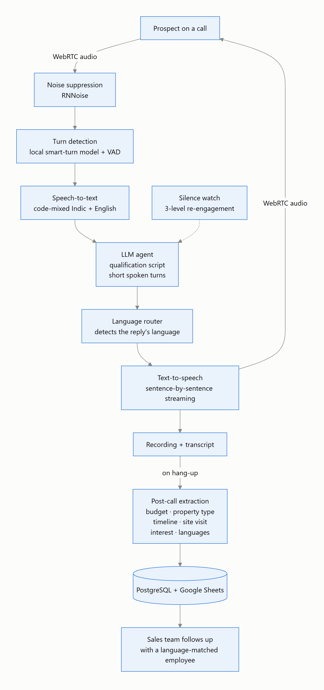
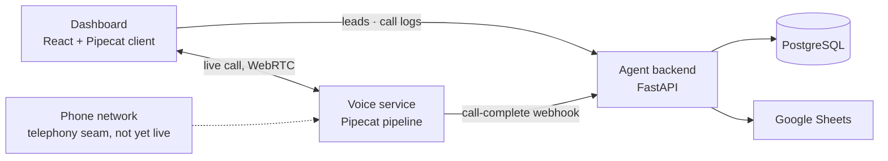

# AIOS: Multilingual AI Voice Agent for Lead Qualification

A real-time voice agent that calls property leads, holds the qualification conversation in the prospect's own language (11 Indian languages, Kannada first), and hands the sales team structured, language-tagged results after every call.

> **Note:** The source code is private. This repository documents the architecture, design decisions and status. I'm happy to walk through the implementation in an interview.

> **Status: prototype (June 2026).** The complete call pipeline is built for browser calls over WebRTC: the agent talks, listens, switches language and logs structured results. The phone-line integration is built but switched off until telecom registration is complete, and a step-by-step conversation state machine with tool calls is the next planned upgrade.

<picture>
  <source media="(prefers-color-scheme: dark)" srcset="assets/call-pipeline-dark.png">
  
</picture>

---

## Overview

A real-estate developer's sales team has to call large numbers of leads just to find out who is serious: budget, the kind of property, when they plan to buy, and whether they'd visit the site. Many prospects are most comfortable in Kannada or Hindi, and most mix English into their speech.

AIOS makes that first call. It opens in Kannada, follows the prospect into whichever language they answer in, and works through a short qualification script in natural spoken turns. When the call ends, it turns the transcript into structured fields and logs them for the sales team, along with the languages the prospect used, so a person who speaks that language can take over the follow-up.

## Key Features

- **Speaks the prospect's language:** opens in Kannada and mirrors the prospect across 11 Indian languages, including mid-call switches.
- **Code-mixed speech recognition:** Indic speech with English words mixed in is transcribed as spoken, with English in Latin script.
- **Natural turn-taking:** a local smart-turn model detects when the speaker has finished, and the prospect can interrupt the agent (two or more words count as a real interruption, so background noise doesn't).
- **Noise suppression:** background noise is filtered out before voice detection.
- **Silence handling:** if the prospect goes quiet, the agent re-engages in three escalating steps.
- **Structured results:** after hang-up, the transcript becomes typed fields (budget range, property type, purchase timeline, site-visit preference, interest, a summary and the languages used), stored in PostgreSQL and a Google Sheet.
- **Dashboard:** add leads, start calls and review call logs with transcripts and extracted fields.

## Architecture

## How It Works

1. A sales user adds a lead in the dashboard and starts a call.
2. Call audio streams over WebRTC to the voice service, where noise suppression and a turn-detection model decide when the prospect has finished speaking.
3. Speech-to-text transcribes the code-mixed speech, and the LLM agent replies with a short spoken turn that follows the qualification script.
4. A language router identifies the language of each reply, so the text-to-speech voice always matches what the agent is saying, and the audio streams back sentence by sentence.
5. On hang-up, the voice service sends the transcript to the agent backend, which extracts the structured lead fields with an LLM.
6. The results are written to PostgreSQL and the sales team's Google Sheet, ready for a language-matched follow-up.

## Results

| What the prototype covers | |
|---|---|
| Languages the agent can switch into | 11 (Kannada, Hindi, English, Tamil, Telugu, Malayalam, Marathi, Bengali, Gujarati, Punjabi, Odia) |
| Lead fields extracted after each call | 7, plus the languages used |
| Re-engagement levels for silence | 3 |
| Transports | Browser WebRTC (live); phone line (built, not yet live) |

The pipeline emits latency metrics for every stage, but it hasn't been load-tested or measured on real customer calls yet, so there are no performance figures to report.

## Tech Stack

| Category | Tools |
|---|---|
| Voice pipeline | Pipecat, SmallWebRTC transport, Silero VAD, local smart-turn model, RNNoise |
| Speech and language models | Sarvam AI: Saaras v3 speech-to-text (code-mix), Sarvam-M LLM, Bulbul v3 text-to-speech, text language identification |
| Backend | FastAPI, Pydantic, async SQLAlchemy, PostgreSQL 16 |
| Integrations | Google Sheets (gspread), telephony WebSocket transport |
| Frontend | React 19, Pipecat JavaScript client |
| Deployment | Docker Compose |

## Engineering Decisions

- **Build the pipeline instead of renting it:** the first version ran on a hosted voice-agent platform, which suffered broken streaming, slow language switches, voice detection that cut people off mid-sentence and silent text-to-speech. Rebuilding on an open-source pipeline gave full control over every stage.
- **Let the language follow the conversation:** language switching is the model's judgment, not a hard-coded rule, and the speech voice follows the detected language of each reply, so a mid-call switch to Hindi or English just works.
- **Short, speakable replies:** turns are capped at about 30 words, numbers are spelled out, no formatting characters are allowed and the model's thinking mode is off. This keeps responses fast and natural to hear.
- **Two words to interrupt:** a single word or a noise burst doesn't stop the agent, which avoids false barge-ins in noisy surroundings.
- **Sentence-level speech:** text-to-speech works sentence by sentence with Indian number formatting (1,00,000 is read as "one lakh"), so audio starts sooner and sounds natural.
- **One pipeline, swappable transport:** the same conversation pipeline runs over browser WebRTC today and over the phone network later; only the transport changes.

## My Role

I designed and built AIOS end to end: the real-time voice pipeline and its turn-taking, noise and language handling, the agent backend with post-call extraction and logging, the telephony seam, and the React dashboard.

## Contact

**Zayed Makandar** | [zayedmakandar03@gmail.com](mailto:zayedmakandar03@gmail.com) | [LinkedIn](https://www.linkedin.com/in/zayed-makandar-642536422/) | [Portfolio](https://zayedmakandar.com)
